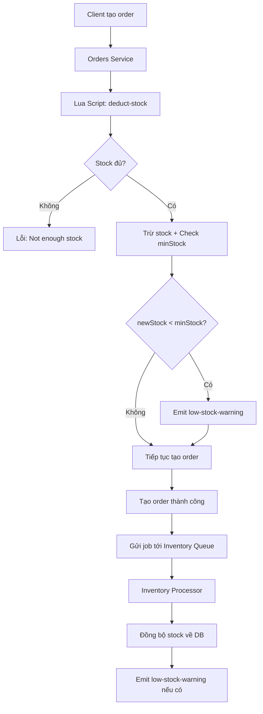

# Tính năng Cảnh báo Low Stock

## 📋 Tổng quan

Tính năng này tự động cảnh báo admin khi nguyên liệu đạt ngưỡng tối thiểu (minStock) sau khi tạo đơn hàng. Đơn hàng vẫn được tạo thành công, nhưng admin sẽ nhận được thông báo để chuẩn bị bổ sung nguyên liệu.

## 🔧 Cách hoạt động

### 1. **Lua Script (deduct-stock.lua)**

- Kiểm tra và trừ stock nguyên liệu
- Phát hiện khi `newStock < minStock`
- Trả về thông tin `lowStock` trong response

### 2. **Orders Service**

- Nhận thông tin `lowStock` từ Lua script
- Lấy thông tin chi tiết nguyên liệu từ Redis
- Emit WebSocket event `low-stock-warning` tới ManagerRoom

### 3. **Inventory Processor**

- Xử lý job đồng bộ stock từ Redis về DB
- Nhận thông tin `lowStockItems` từ job data
- Lấy thông tin chi tiết từ DB và emit cảnh báo

## 📡 WebSocket Events

### Event: `low-stock-warning`

```typescript
{
  message: 'Cảnh báo: Một số nguyên liệu đã đạt ngưỡng tối thiểu',
  lowStockItems: [
    {
      ingredientId: 1,
      ingredientName: 'Thịt bò',
      currentStock: 5,
      minStock: 10,
      unit: 'kg'
    }
  ],
  orderId?: 123, // Chỉ có trong inventory processor
  timestamp: '2024-01-01T00:00:00.000Z'
}
```

## 🎯 Kịch bản sử dụng

### Scenario 1: Đơn hàng thành công + Cảnh báo

```
- Stock hiện tại: 15kg
- MinStock: 10kg
- Order cần: 8kg
- Sau khi trừ: 7kg < 10kg → Cảnh báo
- Đơn hàng: ✅ Thành công
```

### Scenario 2: Đơn hàng thất bại

```
- Stock hiện tại: 5kg
- Order cần: 8kg
- 5kg < 8kg → Lỗi "Not enough stock"
- Đơn hàng: ❌ Thất bại
```

## 🚀 Cách test

### 1. **Chạy script test**

```bash
npx ts-node src/scripts/test-low-stock-warning.ts
```

### 2. **Test thực tế**

```bash
# Khởi động server
npm run dev

# Kết nối WebSocket
const socket = io('http://localhost:3000')
socket.emit('join-room', { roomId: 'MANAGER_ROOM' })

# Lắng nghe cảnh báo
socket.on('low-stock-warning', (data) => {
  console.log('Cảnh báo low stock:', data)
})
```

### 3. **Tạo order test**

```bash
POST /api/guest/create-order
{
  "guestId": 1,
  "orderItems": [
    {
      "skuId": 1,
      "quantity": 2
    }
  ]
}
```

## 📊 Monitoring

### Logs quan trọng

- `Low stock warning:` - Cảnh báo từ orders service
- `Cảnh báo lowStock cho đơn hàng X:` - Cảnh báo từ inventory processor

### Redis Keys

- `ingredient:{id}` - Thông tin nguyên liệu
- `recipe:{skuId}` - Recipe của SKU

## 🔄 Flow hoàn chỉnh



## ⚙️ Cấu hình

### Constants

```typescript
// src/shared/constants/others.constant.ts
export const WS_EVENTS = {
  NEW_ORDER: 'new-order',
  LOW_STOCK_WARNING: 'low-stock-warning',
  NOT_ENOUGH_INGREDIENT: 'not-enough-ingredient',
} as const
```

### ManagerRoom

- Room WebSocket dành cho admin
- Nhận tất cả thông báo quan trọng
- Join: `socket.emit('join-room', { roomId: 'MANAGER_ROOM' })`

## 🐛 Troubleshooting

### 1. **Không nhận được cảnh báo**

- Kiểm tra WebSocket connection
- Đảm bảo join đúng ManagerRoom
- Kiểm tra logs của orders service

### 2. **Lua script lỗi**

- Kiểm tra Redis connection
- Verify script được load đúng
- Check format của orderItems

### 3. **Job queue không chạy**

- Kiểm tra BullMQ connection
- Verify Redis queue config
- Check inventory processor logs
