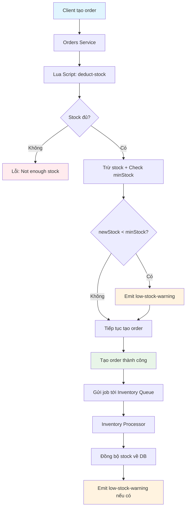

# Low Stock Warning Flow

## Mermaid Diagram



## Chi tiết từng bước

### 1. **Client Request**

```typescript
POST /api/guest/create-order
{
  "guestId": 1,
  "orderItems": [
    { "skuId": 1, "quantity": 2 }
  ]
}
```

### 2. **Lua Script Processing**

```lua
-- deduct-stock.lua
for _, skuItem in ipairs(json) do
  -- Đọc recipe của SKU
  -- Tính toán nguyên liệu cần thiết
  -- Kiểm tra stock đủ không
  if stock < needQty then
    -- Lỗi: Không đủ stock
  else
    -- Trừ stock
    local newStock = stock - needQty
    if newStock < minStock then
      -- Thêm vào lowStock array
      table.insert(lowStock, {
        ingredientId = ing.ingredientId,
        newStock = newStock,
        minStock = minStock
      })
    end
  end
end
```

### 3. **Orders Service Response**

```typescript
{
  errors: [],
  updated: [{ ingredientId: 1, newStock: 5 }],
  lowStock: [{ ingredientId: 1, newStock: 5, minStock: 10 }]
}
```

### 4. **WebSocket Notification**

```typescript
// Orders Service
this.appGateway.server.to(ManagerRoom).emit(WS_EVENTS.LOW_STOCK_WARNING, {
  message: 'Cảnh báo: Một số nguyên liệu đã đạt ngưỡng tối thiểu',
  lowStockItems: lowStockDetails,
  timestamp: new Date().toISOString(),
})

// Inventory Processor
this.appGateway.server.to(ManagerRoom).emit(WS_EVENTS.LOW_STOCK_WARNING, {
  message: 'Cảnh báo: Một số nguyên liệu đã đạt ngưỡng tối thiểu',
  lowStockItems: lowStockDetails,
  orderId: orderId,
  timestamp: new Date().toISOString(),
})
```

### 5. **Admin Dashboard**

```javascript
// Frontend WebSocket listener
socket.on('low-stock-warning', (data) => {
  showNotification({
    type: 'warning',
    title: 'Cảnh báo nguyên liệu',
    message: data.message,
    items: data.lowStockItems,
    timestamp: data.timestamp,
  })
})
```

## Các trường hợp xử lý

### ✅ **Trường hợp 1: Đủ stock, không cảnh báo**

- Stock: 20kg, MinStock: 10kg, Cần: 5kg
- Kết quả: Order thành công, không cảnh báo

### ⚠️ **Trường hợp 2: Đủ stock, có cảnh báo**

- Stock: 15kg, MinStock: 10kg, Cần: 8kg
- Sau trừ: 7kg < 10kg
- Kết quả: Order thành công + Cảnh báo

### ❌ **Trường hợp 3: Không đủ stock**

- Stock: 5kg, Cần: 8kg
- Kết quả: Order thất bại + Lỗi "Not enough stock"

## Monitoring & Logs

### Logs quan trọng

```bash
# Orders Service
[INFO] Low stock warning: [{ ingredientId: 1, newStock: 5, minStock: 10 }]

# Inventory Processor
[WARN] Cảnh báo lowStock cho đơn hàng 123: [{ ingredientId: 1, newStock: 5, minStock: 10 }]

# WebSocket
[INFO] Emitting low-stock-warning to MANAGER_ROOM
```

### Redis Keys được sử dụng

```
ingredient:1 -> { stock: 5, minStock: 10, name: "Thịt bò", unitId: "kg" }
recipe:1 -> [{ ingredientId: 1, quantity: 2, unitId: "kg" }]
```
